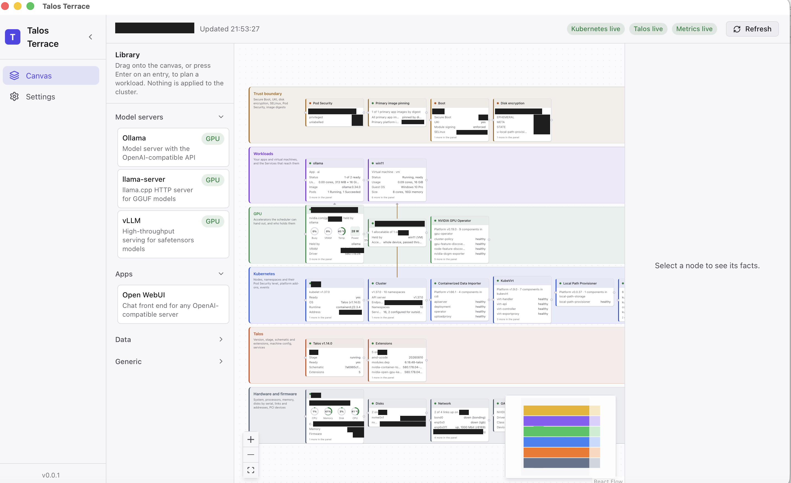

<div align="center">

# Talos Terrace

### Your whole Talos cluster — bare metal to trust boundary — in one live picture.

[](LICENSE)
[-yellow.svg)](docs/roadmap.md)
[](https://www.talos.dev/)
[](https://kubernetes.io/)
[](#develop)

**Installs nothing on your cluster. No agent, no operator, no Helm chart.**<br>
Just the `talosconfig` and `kubeconfig` you already have.



</div>

## Why

`talosctl get` and `kubectl get` answer questions one at a time, in text, about one resource.
Nobody holds thirty of those answers in their head at once — so the things that matter across
layers go unnoticed. Is Secure Boot actually on? Which of those namespaces is `privileged`?
Which pod is holding the GPU right now? Is that volume encrypted?

Talos Terrace draws all of it at once, from the two APIs your cluster already exposes, and
keeps it live. **The trust boundary is a layer you can see, not a claim in a runbook.**

|  |  |
|---|---|
| 🔒 **The trust boundary, drawn** | Secure Boot, UKI, disk encryption, SELinux, Pod Security, image digests — around your workloads, with the evidence behind each one |
| ⚡ **Live, not polled** | Watch streams from both APIs. A pod dies, a node upgrades, a VM boots — the canvas changes as it happens |
| 🎮 **GPU-aware** | Every accelerator the scheduler hands out, and exactly who is holding it. Busy, VRAM, temperature, power |
| 🖥️ **VMs first-class** | KubeVirt virtual machines get a card like anything else: size, address, disks, Secure Boot state |
| 📊 **Metrics with nothing installed** | CPU, memory, disk, network and temperature from the kubelet and Talos themselves. No metrics stack required |
| 🔍 **Your apps, not the machinery** | Every pod traced to the thing you'd actually name. Operators and add-ons fold away into one card each |

## What it shows

Six layers, every one of them live:

```text
┌──────────────────────────────────────────────────────────────────────┐
│ Trust boundary   Secure Boot, UKI, disk encryption, SELinux, PSA …   │
│ Workloads        Deployments, Services, volumes                      │
│ GPU              accelerators the scheduler hands out, who holds them│
│ Kubernetes       nodes, namespaces, platform add-ons, events         │
│ Talos            version, stage, schematic, extensions, config       │
│ Hardware         system, CPUs, memory, disks, links, PCI devices     │
└──────────────────────────────────────────────────────────────────────┘
```

Terrace is to `talosctl` what a Kubernetes IDE is to `kubectl`, with the machine as a
first-class object and the trust boundary drawn rather than implied. It uses the `talosconfig`
and `kubeconfig` you already have, installs nothing on the cluster, and every mutating action
(when they arrive) shows its diff and asks first.

**What you run versus what the cluster runs.** Every pod is traced to the thing a person would
name: a Deployment, a DaemonSet, a Job, a KubeVirt virtual machine, a static control-plane
pod. Your apps get a card each in the Workloads layer (a virtual machine shows its size,
address, disks and Secure Boot state). The machinery, operators and add-ons such as the GPU
Operator or KubeVirt, folds into one card per namespace with its version and health, and
Kubernetes' own components into one more. The guess is by namespace; Settings lets you move a
namespace either way.

## Where it is

**Early — milestone M0, read-only, September 2026. No binaries yet: [build from source](#develop).**
One cluster at a time, every node in the talosconfig. Kubernetes objects and events arrive over
watch streams, and a change on a Talos node re-reads its inventory. Checked against Talos v1.14
and Kubernetes v1.37. Composing and applying come next — see the [roadmap](docs/roadmap.md).

## Principles

1. **Git is the source of truth.** Terrace reads live state today. Planned write support will
   produce declarations as files and preview the diff before applying them.
2. **Two APIs, nothing on the cluster.** Talos (talosconfig) and Kubernetes (kubeconfig),
   over the network path and authentication configured in those files.
3. **Read-only first.** Future mutating actions must be explicit and previewed, with their
   risks and recovery options shown.
   `talosctl bootstrap` and `talosctl reset` are never one click away.
4. **Live, not polled.** Watch streams from both APIs; the Refresh button exists for the
   optional integrations the watches do not cover.
5. **The trust boundary is a layer, not a badge.** Boot, encryption, admission, digests,
   provenance: drawn around the workloads with the evidence behind it.
6. **No inference in the console.** Integrations such as Ollama are optional and only ever
   clients of servers you run.

## Develop

Prerequisites: Node 22.12 or newer, Rust stable (1.89 or newer), and the platform
dependencies Tauri lists for your OS in its
[prerequisites guide](https://tauri.app/start/prerequisites/) (on Debian and Ubuntu:
`libwebkit2gtk-4.1-dev build-essential curl wget file libxdo-dev libssl-dev
libayatana-appindicator3-dev librsvg2-dev`; macOS needs the Xcode command line tools; Windows
needs the C++ build tools and WebView2). `talosctl` on your `PATH` (the Talos API is read
through it for now).

```bash
npm ci                 # exact versions from package-lock.json
npm run dev            # the app, with hot reload (`web:dev` is the Vite server alone)
npm run check          # prettier, eslint, tsc, vitest
npm run rust:check     # cargo fmt, clippy -D warnings, cargo test
```

The first `npm run dev` compiles the Rust side, which takes a few minutes. CI runs the same
checks on every push and pull request (`.github/workflows/ci.yml`), on Linux, macOS and
Windows; a weekly workflow audits the dependencies and checks the documentation links.

**First run.** The app opens on the canvas with nothing connected. Open **Settings**, point
it at your kubeconfig (and the context to use) and your talosconfig, and press the connection
tests; each one says what it reached. Back on the canvas the three badges in the header go
live one by one and the layers fill in. Nothing you do in the app changes the cluster.

To see exactly what Terrace reads from a cluster, without the app:

```bash
cd src-tauri
cargo run --example probe -- --context my-cluster            # one read, JSON on stdout
cargo run --example probe -- --watch 60 | jq -c 'keys'       # plus a minute of live pushes
```

## Configure

Open **Settings** in the app. Terrace stores only *paths* and optional URLs:

| Setting | Default |
|---|---|
| Kubeconfig path | `~/.kube/config` |
| Kubernetes context | the file's `current-context` |
| Talosconfig path | `$TALOSCONFIG`, then `~/.talos/config` |
| `talosctl` binary | `talosctl` on `PATH` |
| Ollama URL (optional) | empty; set it to show an Ollama server on the canvas |
| Namespaces that are your apps / platform | empty; override the apps-versus-platform guess |
| Sample interval (seconds) | `5`; `0` switches live metrics off |
| GPU metrics exporter (optional) | empty; finds a Service named `nvidia-dcgm-exporter` and reads each pod behind it, or `namespace/name[:port]`, or `off` |
| Host temperature sensors | `on`; read through the Talos API every third sample. Needs an `os:admin` talosconfig; with less, Terrace says so once and leaves them |
| Power budget (watts, optional) | empty; shown against the GPUs' combined draw when set |

Review [the permission guide](docs/rbac/README.md) before enabling proxy access for live
metrics. Ollama URLs must not contain credentials, query parameters or fragments.

Live metrics install nothing: they read the kubelet's summary API and a GPU exporter through
the API server, and the hosts' sensors through the Talos API.

No kubeconfig, talosconfig, key or token is ever copied into Terrace's data directory or this
repository (`.gitignore` refuses the usual names). Secrets, when the first one arrives, go into
the vault: one OS keychain entry holds a master key and everything else is AES-256-GCM in
SQLite.

## Layout

```text
src/                     React 19, TypeScript strict, Vite, @xyflow/react, zustand
  pages/Canvas/          layers, palette, docs links, fact builders, the canvas, the store
                         (live summaries land there), the per-source live badges
  pages/Settings/        paths, optional integrations, connection tests, theme
  services/api.ts        every Tauri command and event name, typed; components never call invoke
  styles/                tokens (dark and light), base, layouts, components
src-tauri/src/           Rust
  error.rs               the one error type, serialised as { code, message }
  db/                    SQLite with PRAGMA user_version migrations
  vault/                 keychain master key, AES-GCM blobs
  cluster/               kube-rs over rustls, read-only: connect, list, summarise; workload
                         roots from pods, KubeVirt VMs when served, app/platform/system roles
  talos/                 talosctl sidecar (version, get, get --watch) and the node inventory
  watch/                 the live path: reflectors and talosctl watch triggers, pushed as events
  ollama/                optional integration
  commands/              async Tauri commands
src-tauri/examples/      probe: the same reads and watches, headless, as JSON
docs/                    roadmap, architecture, decisions, inventory and optional metrics roles, the
                         signing and notarization runbooks
```

## Documentation

- [Roadmap](docs/roadmap.md): where Terrace is going, milestone by milestone, and what is
  done. In short: inventory and health live over watch streams; the machine config as code
  (documents, patches, `dry-run` diffs, drift against Git); guarded lifecycle operations
  (upgrades through Image Factory schematics, Kubernetes upgrades, reboot, etcd care); a
  bootstrap wizard; the trust layer through to signatures and attestation; an MCP server so
  agents can read the cluster and propose changes through the same gates.
- [Architecture](docs/architecture.md): the layer model, the modules, the live path, how
  workloads are found and classified, the headless probe.
- [Decisions](docs/decisions/README.md): the choices that shaped Terrace and why.
- [Changelog](CHANGELOG.md): what changed, release by release.
- [Kubernetes permissions](docs/rbac/README.md): a base reader role and a separate optional
  metrics proxy role. The proxy grant can authorize more than reads; review it before binding.
- [Signing](docs/signing.md) and [notarization](docs/notarization.md) runbooks for the
  releases to come.

## Lifted from Modz

Terrace starts from proven pieces of Modz (MIT), the author's own Tauri 2 desktop platform:
the React Flow canvas pattern and its CSS, the design tokens, the ESLint and Prettier setup,
the services layer, the vault, the logging module, the Tauri command conventions and the
signing runbooks. Each lifted file carries a header saying so.

## Contributing and security

Bug reports against real clusters are the most useful thing right now; see
[CONTRIBUTING.md](CONTRIBUTING.md). Vulnerabilities go through
[SECURITY.md](SECURITY.md), never through a public issue. Everyone taking part is bound by the
[code of conduct](CODE_OF_CONDUCT.md).

## Licence

[Apache License 2.0](LICENSE). The pieces lifted from Modz are MIT; their notice is in
[NOTICE](NOTICE).
